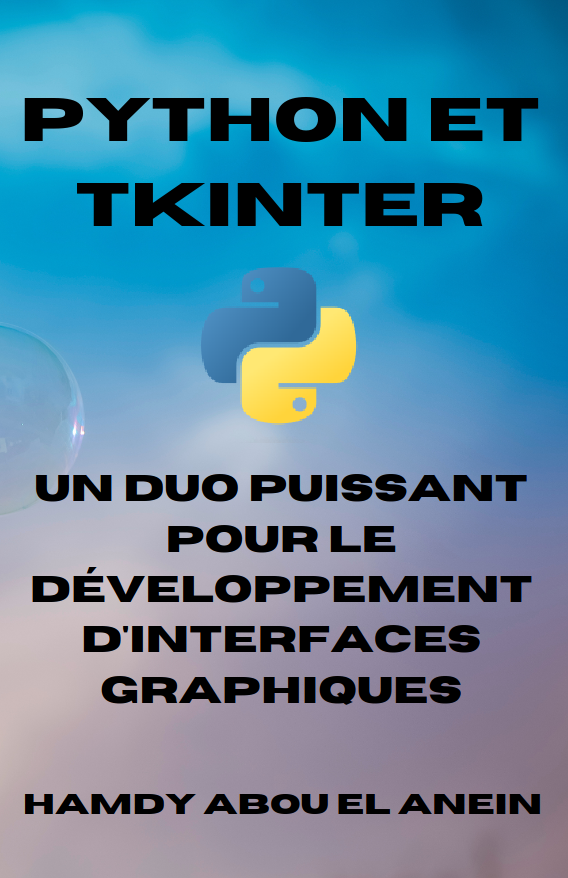

# Programmes du livre : [Python et Tkinter : un duo puissant pour le développement d'interfaces graphiques](https://www.amazon.fr/dp/B0C2RTBS6W)      
       

Auteur : [Hamdy Abou El Anein](https://www.amazon.fr/Hamdy-Abou-El-Anein/e/B0BM89T88X/ref=aufs_dp_fta_dsk)    

## Maintenance and regression tests

Maintainer: Hamdy Abou El Anein — hamdy.aea@protonmail.com

Install `requirements.txt` in a virtual environment. Run `python3 -m unittest -v` from the repository root. The task list handles deletion before selection, ignores whitespace-only entries and reads the current selection before deletion. Image examples resolve their assets independently of the working directory. Three actual Tk widget tests pass; a display or Xvfb is required. Original chapter organization is retained.
